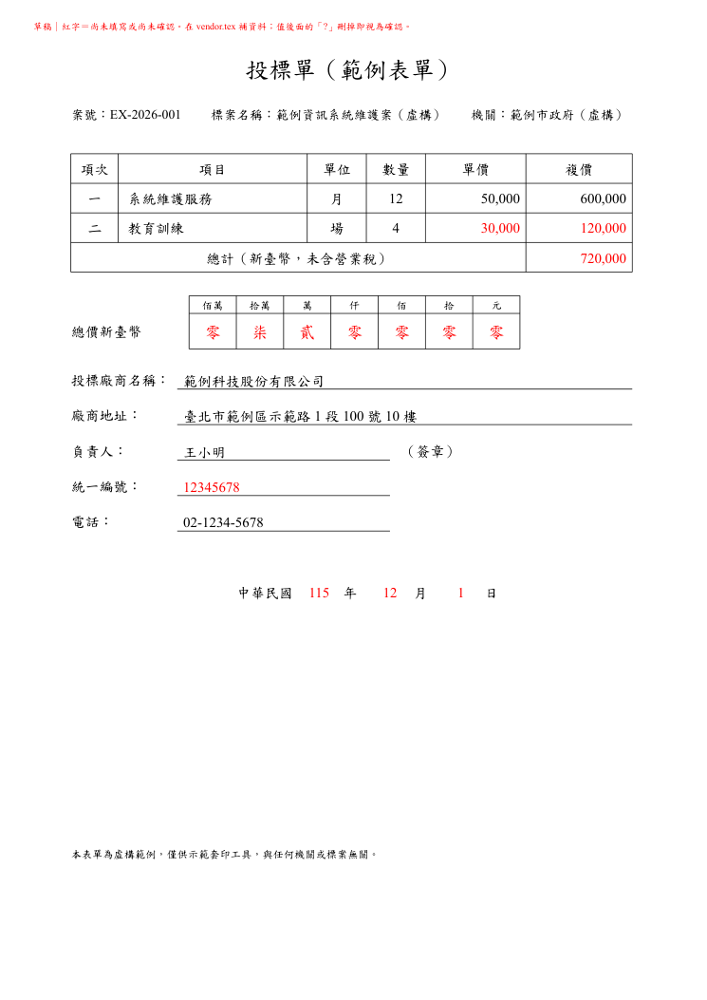

# tw-tender-overlay｜台灣政府採購投標表單套印工具＋AI Agent Skill

把廠商資料「疊印」在機關提供的**原始表單 PDF** 上：表單本身完全不改，只在欄位位置印字。
再搭配一個 AI agent skill（Claude Code 格式），把「拿到招標包 → 整理重點 → 填表 → 檢查 → 列印」變成可重複的流程。



## 解決什麼問題

政府採購的投標表單（投標單、聲明書、資格審查單、三用表單…）多半是 PDF 或掃描檔，手寫或用 Word 重打都容易出錯。這個工具的做法是：

- **原始表單不動**：用 LaTeX `pdfpages` 載入機關的 PDF，在量好的座標上印字，版面跟原件一模一樣。
- **資料集中一個檔**：公司資料、聲明書答案、價格都寫在 `vendor.tex`，換主體、換價格，所有表單同步更新。
- **三種狀態一眼看出**：
  - 空白：草稿印紅色〔提示〕，代表還沒填。
  - 值後面加 `?`：紅字，代表建議值、尚未確認。
  - 其他：黑字，代表已確認。

  正式版只印已確認的內容，未確認的欄位留白，可以印出來再手寫。
- **三種輸出**：
  - 草稿 `forms.pdf`（`\drafttrue`）。
  - 預覽 `preview.pdf`：未確認的值也印黑字，用來看版面。
  - 正式版 `forms.pdf`（`\draftfalse`）。

## 內容

| 路徑 | 說明 |
|---|---|
| `core/overlay-core.tex` | 套印巨集：`\putl/\putc/\putr` 放字、`\val` 必填欄、`\decl` 是否勾選、`\chk` 勾選框、`\digit` 中文大寫格、`\fitw` 超寬自動縮小、`\putwrap` 自動換行 |
| `example/` | 完整範例：虛構表單 `src/sample_form.pdf`、座標 `forms.tex`、資料 `vendor.tex`、主體資料 `entity/` |
| `tools/new_tender.py` | 開新標案：解壓招標包（處理 Big5 檔名）、讀招標單欄位、算疑義期限、複製套印範本、產準備清單初稿、編譯 |
| `tools/coords.py` | 列出 PDF 每段文字的座標（量欄位位置） |
| `tools/lines.py` | 列出表格格線、每個字的 x 範圍（量勾選欄、格子） |
| `tools/render.py` | PDF 指定頁面轉 PNG（檢查疊印位置） |
| `tools/itbdiff.py` | 比對兩版投標須知或招標文件的文字差異 |
| `tools/cn_amount.py` | 金額轉投標單中文大寫格（例：720000、7 格 → 零柒貳零零零零） |
| `skill/tw-gov-tender/` | AI agent skill：投標準備的流程與硬性規則 |
| `docs/lessons.md` | 投標準備常見陷阱清單 |

## 快速開始

需要：[Tectonic](https://tectonic-typesetting.github.io/)（或 TeX Live 的 `xelatex`）、Python 3.9+、`pip install pypdf pymupdf`。
中文字型會自動找標楷體 → 全字庫正楷體 → Noto CJK TC，也可以在 `vendor.tex` 指定 `\TenderCJKFont`。

```bash
cd example
tectonic -X compile forms.tex      # 草稿：紅字＝未確認
tectonic -X compile preview.tex    # 預覽：看填好的樣子
```

跑一次「開新標案」流程（用虛構的招標包）：

```bash
python tools/new_tender.py example/sample-forms/demo_package.zip demo_out --kit example --announce 2026-12-01 --entity example/entity/example_co.tex
```

## 套用到真正的標案

1. 把機關的表單 PDF 放進 `src/`，在 `kit.json` 設定招標包裡哪份檔案對應哪個表單。
2. 量座標：
   ```bash
   python tools/coords.py src/表單.pdf 1        # 文字基線
   python tools/lines.py  src/表單.pdf 1        # 表格格線
   ```
3. 在 `forms.tex` 為每一頁寫一個 overlay 巨集，例如：
   ```latex
   \newcommand{\OverlayBid}{%
     \putl{155,519}{\fitw{375bp}{\val\VendorName{廠商全銜}}}%
     \putr{440,673}{\val\PriceUnitA{單價}}%
     \decl{\DeclI}{695}%
   }
   \includepdf[pages=1, fitpaper, picturecommand*={\OverlayBid}]{src/表單.pdf}
   ```
4. 每個欄位先填假資料，用 `tools/render.py forms.pdf 1 check 150` 檢查有沒有壓到格線，再換成真資料。

## AI Agent Skill

`skill/tw-gov-tender/SKILL.md` 是給 AI coding agent（例如 Claude Code）的工作流程。安裝方式：複製到 `~/.claude/skills/tw-gov-tender/`。之後說「開新標案」並給招標包，agent 會照流程執行。

skill 的硬性規則：
- 產出都是草稿。
- 投標主體、價格、聲明書答案、簽署人一律由使用者決定。
- agent 不代為送件或寄信。
- 機關提供的保密資料不放進範本。

## 免責聲明

- 本工具只協助「排版與檢查」，**不構成法律或採購意見**。投標文件是否合格，以各機關招標文件和審查結果為準。
- 範例中的機關、標案、公司、人名、統編都是虛構的。
- 表單 PDF 的著作權屬於原發布機關；本 repo 不附任何真實機關的表單，請自行從政府電子採購網或招標機關取得。

## License

MIT，見 [LICENSE](LICENSE)。
